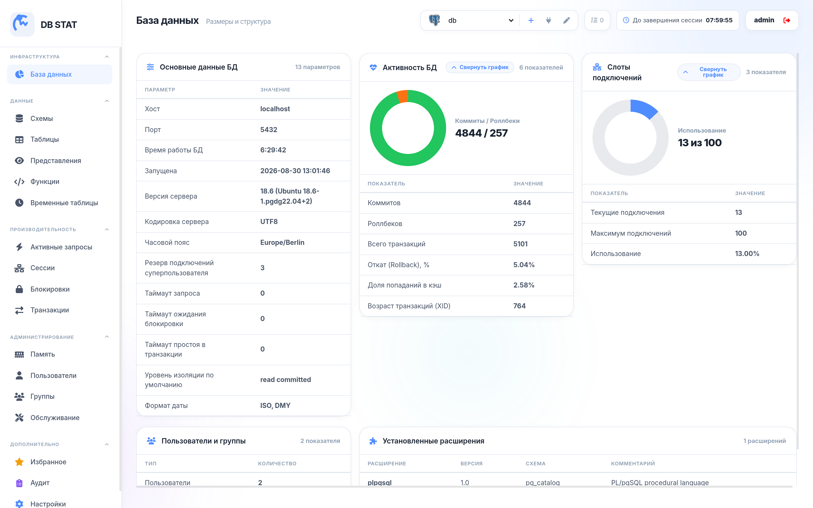
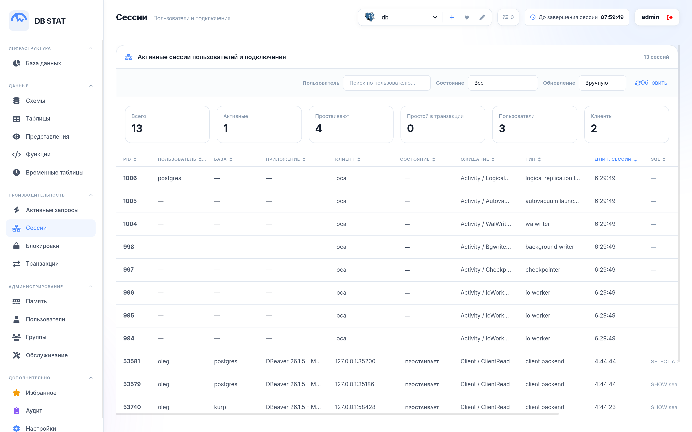
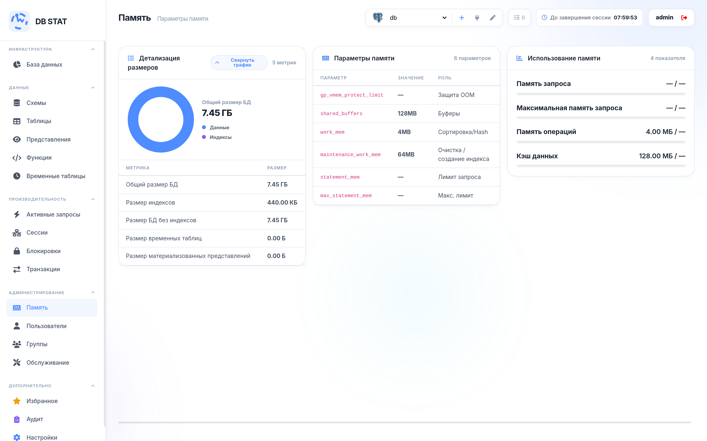
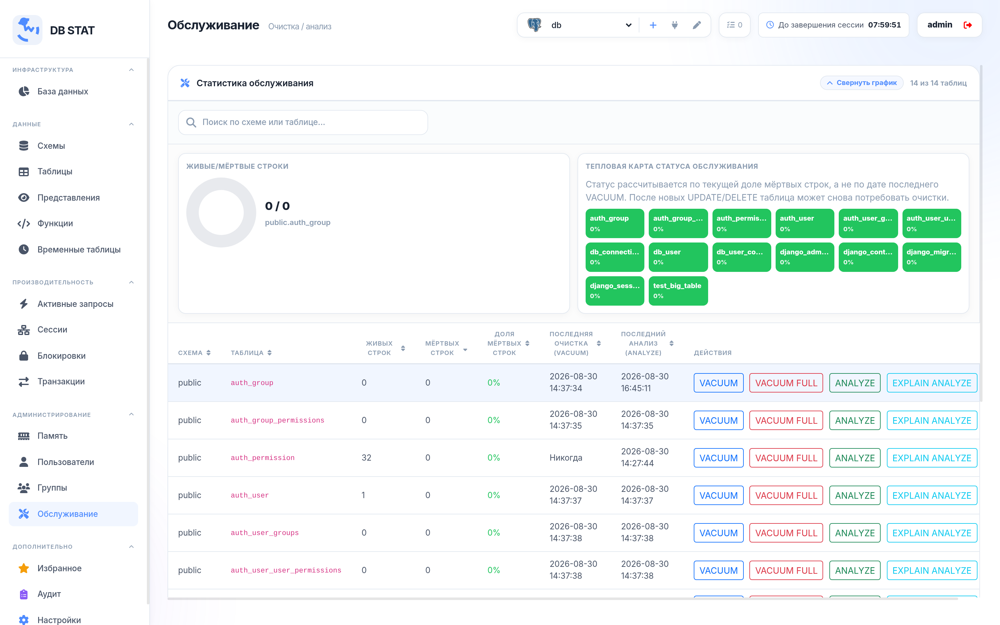

#   DB STAT

**Русский** | [English](README.en.md)

DB STAT — веб-приложение для мониторинга и диагностики баз данных PostgreSQL, Greenplum и Greengage: запросы, блокировки, размеры, обслуживание и PDF-отчёты в одном окне.

[Видео на YouTube](https://youtu.be/9NN8SoxMOZA)

<table>
  <tr>
    <td align="center"> База данных — размер и активность</td>
    <td align="center"> Сессии — кто и что делает сейчас</td>
  </tr>
  <tr>
    <td align="center"> Память — параметры и использование</td>
    <td align="center"> Обслуживание — VACUUM и ANALYZE</td>
  </tr>
</table>

## Возможности

- Активные запросы, сессии и блокировки; завершение процессов (для администратора).
- Размеры баз, схем и таблиц, временные и TOAST-таблицы.
- VACUUM и ANALYZE в фоне; PDF-отчёт по подключению на русском или английском.
- Журнал аудита; роли «Администратор» и «Аналитик».

## Установка и запуск

Подробная инструкция — в [docs/DEVELOPMENT.md](docs/DEVELOPMENT.md).

## Лицензия

[MIT](LICENSE)
